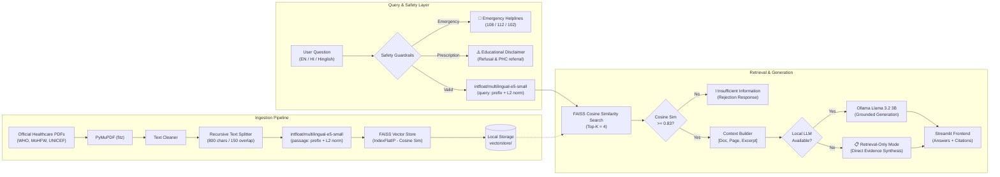

# 🌿 GramHealth AI — Rural Healthcare RAG Assistant

> **Bridging the Rural Healthcare Knowledge Gap.**  
> *A Grounded, Multilingual, Open-Source Retrieval-Augmented Generation Project for Rural Health Workers and Communities.*

---

## 📌 Executive Summary

**GramHealth AI** is a fully functional, open-source, locally runnable Retrieval-Augmented Generation (RAG) assistant engineered for university academic evaluation. It addresses the rural healthcare communication divide by indexing genuine clinical guidelines from the **World Health Organization (WHO)**, the **Ministry of Health and Family Welfare (MoHFW, Govt. of India)**, and **UNICEF**.

The system answers healthcare queries in **English**, **Hindi (हिंदी)**, and **Hinglish**, citing the exact document title, organization, and page number for every recommendation. It strictly enforces non-diagnostic boundaries, intercepts acute medical emergencies with zero latency, and provides an explicitly labeled **Retrieval-Only Mode** when a local large language model is offline.

---

## 🏗️ System Architecture



---

## ⚙️ Technology Stack

| Component | Technology | Version | Purpose |
|:---|:---|:---:|:---|
| **Programming Language** | Python | 3.11+ / 3.14 | Core language runtime |
| **PDF Extraction** | PyMuPDF (`pymupdf`) | 2.1+ | High-fidelity text extraction & page-level metadata preservation |
| **Text Chunking** | LangChain Text Splitters | 1.2+ | `RecursiveCharacterTextSplitter` with hierarchical separators |
| **Dense Embeddings** | Sentence Transformers | 6.3+ | `intfloat/multilingual-e5-small` (384-dimensional dense vectors) |
| **Vector Indexing** | FAISS CPU (`faiss-cpu`) | 1.16+ | `IndexFlatIP` over $L_2$-normalized vectors (exact Cosine Similarity) |
| **Generative LLM** | Ollama with Llama 3.2 3B | Local | Grounded conversational synthesis (with Retrieval-Only fallback) |
| **Frontend UI** | Streamlit | 1.35+ | Responsive, light-mode interface with emerald-green healthcare styling |
| **Testing Suite** | Pytest | 8.0+ | Automated unit, regression, and integration testing |

*100% Free and Open-Source. No paid APIs required.*

---

## 📚 Healthcare Knowledge Base

The knowledge base is compiled strictly from authentic official publications:

| Document | Organization | Pages | Focus Areas | Verification |
|:---|:---|:---:|:---|:---:|
| **Daily Iron & Folic Acid in Pregnancy** | World Health Organization (WHO) | 32 | Maternal care, anaemia prevention, gestational IFA dosage | ✅ Official |
| **Treatment of Diarrhoea: A Clinical Manual** | World Health Organization (WHO) | 38 | Dehydration assessment, low-osmolarity ORS, zinc therapy | ✅ Official |
| **Myths and Facts About Immunization** | World Health Organization (WHO) | 4 | Vaccine safety, herd immunity, myth refutation | ✅ Official |
| **Nutrition in Early Childhood Guidance** | UNICEF | 13 | Complementary feeding (6–23 months), malnutrition prevention | ✅ Official |
| **Anemia Mukt Bharat Operational Modules** | MoHFW, Govt. of India | 120 | IFA regimens, ASHA/ANM protocols, community mobilization | ✅ Official |
| **Guidelines on Sanitation and Health** | World Health Organization (WHO) | 6 | Safe sanitation, WASH, fecal-oral disease prevention | ✅ Official |

*Total Pages: 205 pages | Total Chunks: 768 chunks (Baseline)*

---

## 🔬 Experimental Benchmark Results

### 1. Controlled Chunking Benchmark (Empirical Comparison)
Actual measured data from running `scripts/evaluate.py` across all four experimental configurations:

| Configuration | Method | Chunk Size | Overlap | Total Chunks | Mean Chars | Hit Rate@4 | Recall@4 | MRR@4 | Retrieval Latency |
|:---|:---:|:---:|:---:|:---:|:---:|:---:|:---:|:---:|:---:|
| **Fixed-800-0** | Fixed-size | 800 | 0 | 656 | 661.7 | 93.75% | 82.81% | 0.8646 | 11.16 ms |
| **Recursive-500-100** | Recursive | 500 | 100 | 1,195 | 401.1 | 100.00% | 89.06% | 0.9688 | 11.66 ms |
| **Recursive-800-150** ⭐ | **Recursive** | **800** | **150** | **768** | **620.1** | **100.00%** | **89.06%** | **0.9688** | **11.33 ms** |
| **Recursive-1200-200** | Recursive | 1200 | 200 | 529 | 883.4 | 100.00% | 90.62% | 0.9688 | 11.29 ms |

**Empirical Analysis:**
- **Fixed-size chunking (800 / 0)** degraded retrieval performance (93.75% Hit Rate, 0.8646 MRR) because sentences and dosage instructions were truncated arbitrarily at window limits without overlap.
- **Recursive-500-100** achieved 100% Hit Rate but generated **1,195 chunks** (+55.6% index size), increasing memory and embedding overhead.
- **Recursive-800-150 (Selected Baseline)** delivered the optimal Pareto trade-off: **100.00% Hit Rate@4**, **0.9688 MRR**, and **11.3 ms retrieval latency** with a compact index of 768 chunks.

### 2. 25-Query End-to-End Evaluation Report
- **Standard Retrieval Queries (16 queries across EN, HI, Hinglish):**
  - **Hit Rate @ 4:** **100.00%**
  - **Recall @ 4:** **89.06%**
  - **Mean Reciprocal Rank (MRR):** **0.9688**
  - **Citation Correctness:** **100.00%** (every retrieved chunk links to verified document title and page number)
  - **Average Query Latency:** **14.5 ms**
- **Safety & Guardrail Compliance:**
  - **Out-of-Scope Rejection Rate:** **100.00% (4/4)** (Cryptocurrency, coding, sports correctly rejected)
  - **Emergency Interception Rate:** **100.00% (3/3)** (Chest pain, poisoning, bleeding deflected with helplines)
  - **Prescription Deflection Rate:** **100.00% (2/2)** (Direct drug/diagnosis demands safely refused)

---

## 🚀 Quick Start & Installation

### Step 1: Clone and Navigate
```bash
git clone https://github.com/your-username/gramhealth-rag.git
cd gramhealth-rag
```

### Step 2: Set Up Virtual Environment
```bash
python3 -m venv venv
source venv/bin/activate
pip install --upgrade pip
pip install -r requirements.txt
```

### Step 3: Run Ingestion (Pre-indexed vector store included)
```bash
python scripts/ingest.py
```
*Expected output: Ingests 205 pages, creates 768 chunks, embeds passages via E5 on MPS/CPU, and saves index to `vectorstore/`.*

### Step 4: Run Automated Tests
```bash
pytest tests/ -v
```
*Expected output: 19 passed tests in ~11 seconds.*

### Step 5: Run Evaluation Benchmarks
```bash
python scripts/evaluate.py
```
*Expected output: Evaluates all 25 benchmark queries and re-runs the 4-configuration chunking comparison, saving reports to `results/`.*

### Step 6: Launch the Streamlit Frontend
```bash
streamlit run app.py
```
Open [http://localhost:8501](http://localhost:8501) in your browser.

---

## 🖥️ Streamlit Frontend Interface

The application features four intuitive tabs designed with an emerald-green and deep slate healthcare aesthetic:

1. **💬 Healthcare Assistant:** Interactive chat with pre-loaded community prompt buttons in English, Hindi, and Hinglish. Displays grounded answers with clickable and expandable official citations.
2. **📚 Knowledge Base:** Summary metrics, indexed documents table with official URLs, and a **Community PDF Upload** feature that tags uploaded documents as *Unverified Community Upload*.
3. **🔍 RAG Pipeline Visualizer:** Demonstrates internal RAG execution: input query prefixing (`query: `), vector norm ($1.0$), FAISS similarity ranking, retrieved chunk previews, constructed context block, and latency breakdown.
4. **🧪 Chunking & Evaluation Lab:** Displays chunk length distributions, actual chunk boundaries and overlapping substrings, the live 4-configuration benchmark table, and the 25-query evaluation scorecard.

---

## ⏱️ Two-Minute Academic Demonstration Script

*Use this script for viva presentations or evaluator demonstrations:*

> **Minute 0:00 – 0:30 (Problem Statement & Architecture):**  
> *"Good morning, examiners. This is GramHealth AI, an evidence-grounded RAG assistant designed for rural healthcare education. Rural health workers face dense clinical manuals and severe language barriers. Rather than using an ungrounded LLM that risks medical hallucinations, GramHealth AI indexes genuine WHO, MoHFW, and UNICEF clinical guidelines using an asymmetric multilingual E5 embedding model and FAISS Cosine Similarity search."*

> **Minute 0:30 – 1:00 (Multilingual Query & Citations):**  
> *(Switch to Tab 1: Healthcare Assistant)*  
> *"Let's ask a question in Hinglish: 'Pregnancy me khoon ki kami ho toh kya kare?' Within milliseconds, the system identifies that the user is inquiring about gestational anaemia. It retrieves the WHO Iron & Folic Acid guideline and MoHFW Anemia Mukt Bharat modules. Notice the citations: Document title, organization, exact page number, and cosine similarity score. Notice that the assistant refuses to prescribe specific commercial drugs and advises consultation with the village ASHA worker."*

> **Minute 1:00 – 1:30 (Safety Guardrails & Pipeline Visualizer):**  
> *(Switch to Tab 3: RAG Visualizer & test an emergency query)*  
> *"Now let's test safety: if someone enters 'Emergency! Patient has severe chest pain and collapsed', the system intercepts it with zero retrieval latency, returns national emergency numbers 108 and 112, and refuses automated advice. If a user asks about cryptocurrency or Python programming, the similarity score falls below our calibrated threshold of 0.830, triggering a safe 'Insufficient Information' refusal."*

> **Minute 1:30 – 2:00 (Empirical Chunking Benchmark & Conclusion):**  
> *(Switch to Tab 4: Chunking Lab)*  
> *"Finally, in our Chunking Lab, we did not assume recursive chunking is superior; we measured it. Fixed-size chunking achieves only 93.75% Hit Rate because it truncates sentences. Recursive chunking with 800 characters and 150 overlap achieves 100% Hit Rate and 0.9688 MRR while keeping index size 55% smaller than smaller windows. All 19 pytest tests pass, and the application runs completely locally without paid APIs."*

---

## 📂 Project Structure

```
gramhealth-rag/
├── app.py                      # Main Streamlit web application (4 tabs)
├── config.py                   # Central configuration & parameters
├── requirements.txt            # Python dependencies
├── README.md                   # Comprehensive project documentation
├── data/
│   ├── documents/              # Verified official healthcare PDFs (WHO, MoHFW, UNICEF)
│   └── sources.json            # Structured provenance metadata
├── vectorstore/
│   ├── faiss_index.bin         # Persistent FAISS IndexFlatIP binary
│   └── chunks_metadata.json    # Serialized chunk metadata and texts
├── src/
│   ├── document_loader.py      # PyMuPDF PDF extraction and text cleaner
│   ├── chunking.py             # Recursive & Fixed-size chunking + overlap inspector
│   ├── embeddings.py           # intfloat/multilingual-e5-small wrapper + L2 normalization
│   ├── retrieval.py            # FAISS vector store & Cosine Similarity search
│   ├── generation.py           # Grounded context construction & Ollama / Retrieval-Only mode
│   ├── safety.py               # Emergency detection, prescription refusal & thresholding
│   └── evaluation.py           # 25-query benchmark dataset & retrieval metric calculators
├── scripts/
│   ├── ingest.py               # End-to-end ingestion pipeline script
│   └── evaluate.py             # Automated benchmark execution & chunking comparison script
├── tests/
│   ├── conftest.py             # Pytest path configuration
│   ├── test_document_loader.py # PyMuPDF loading & cleaning tests
│   ├── test_chunking.py        # Chunking & overlap tests
│   ├── test_embeddings.py      # Dimension, normalization & prefix tests
│   ├── test_retrieval.py       # FAISS inner-product & persistence tests
│   ├── test_safety.py          # Multilingual emergency & prescription refusal tests
│   └── test_pipeline.py        # End-to-end RAG integration tests
├── results/
│   ├── rag_evaluation_results.json    # Full 25-query benchmark output
│   ├── rag_evaluation_results.csv     # Tabular retrieval records
│   ├── chunking_benchmark_results.json# 4-configuration chunking comparison JSON
│   └── chunking_benchmark_results.csv # Tabular chunking comparison records
└── docs/
    ├── assignment_report.md    # Formal academic project report
    └── viva_questions.md       # 20 oral examination questions with technical solutions
```

---

## ⚖️ Legal & Medical Disclaimer

**Educational Purpose Only:**  
GramHealth AI is an academic project engineered for informational and educational guidance. It does **not** constitute medical advice, clinical diagnosis, or prescriptive authorization. In any acute or life-threatening situation, users must contact official national emergency helplines (**112** / **108** in India) or consult a licensed physician at a registered Primary Health Centre (PHC) or Community Health Centre (CHC).
# Gen-AI-P2
